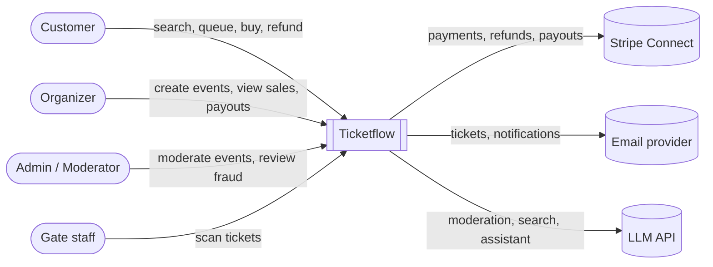

# Ticketflow — Architecture Documentation (arc42)

> Living document based on the [arc42](https://arc42.org) template.
> Sections marked _TBD_ will be filled in as the design matures.
> Decisions are recorded separately as [ADRs](../adr/README.md).

---

## 1. Introduction and Goals

### 1.1 Requirements overview

Ticketflow is a marketplace for event tickets:

- **Organizers** register, create events (concerts, sports, stand-up, festivals, …), define venues,
  seating plans or ticket pools, prices, purchase limits and refund policies. Revenue is paid out
  to organizers; the platform takes a fee.
- Every event listing is **moderated** (automated pre-screening, then admin review when needed)
  before it can go on sale.
- **Customers** browse and search events, pass through a **virtual waiting room**, hold seats for
  10 minutes, pay, and receive a **signed QR ticket** as a PDF by email.
- Organizers can enable **gate scanning**; a ticket can be used only once.
- Customers can **refund** tickets within the organizer's refund window; refunded tickets return to
  the pool. Cancelling an event triggers a **mass refund**.
- Per-event **purchase limits** (default: 1 ticket per person) are enforced without collecting
  additional personal data.
- **Bot and fraud detection** protects on-sales.

### 1.2 Quality goals

| Priority | Quality goal | Scenario |
|---|---|---|
| 1 | **Correctness under concurrency** | Two customers selecting the same seat at the same moment — exactly one gets it. A ticket is never sold twice; a payment is never captured twice. |
| 2 | **Resilience / elasticity** | 100 000 users arrive within one minute of an on-sale. The system stays responsive by admitting users at a controlled rate instead of failing. |
| 3 | **Reliability** | A failing downstream service (payments, email) never loses an order; work is retried or compensated. |
| 4 | **Security** | Tickets cannot be forged; purchase limits cannot be bypassed with multiple accounts; no card data touches our systems. |
| 5 | **Observability** | Any single purchase can be traced end-to-end across all services. |
| 6 | **Maintainability** | Services are independently buildable, testable and deployable; architectural rules are enforced by tests. |

### 1.3 Stakeholders

| Role | Expectation |
|---|---|
| Customer | Fair access to tickets, fast checkout, reliable delivery and refunds |
| Organizer | Simple event setup, reliable sales, transparent payouts |
| Admin / moderator | Efficient review queue, fraud visibility |
| Gate staff | Fast, reliable ticket validation (also with poor connectivity) |
| Developer / operator | Clear boundaries, automated delivery, good diagnostics |

---

## 2. Architecture Constraints

| Constraint | Background |
|---|---|
| Free tiers only | Local k3d, Oracle Cloud Always Free, GitHub free plan, Stripe test mode. AWS credits reserved for short, sessional experiments. |
| Cloud-agnostic | Everything runs on Kubernetes and is provisioned with Terraform, so the target cloud can change. |
| Java / Spring ecosystem | Primary language Java 25 with Spring Boot 4. |
| ARM64 + AMD64 | Oracle Always Free runs on ARM — all images are multi-architecture. |
| No PCI scope | Card data is handled exclusively by Stripe. |
| Single developer | Operational complexity must be automated (CI/CD, GitOps). |

---

## 3. Context and Scope

### 3.1 Business context (C4 — System Context)

### 3.2 Technical context

_TBD — after the container view (section 5) is drafted._

---

## 4. Solution Strategy

| Goal | Approach |
|---|---|
| Independent evolution of domains | Microservices aligned with DDD bounded contexts; database per service ([ADR-0002](../adr/0002-event-driven-microservices.md), [ADR-0006](../adr/0006-polyglot-persistence.md)) |
| Loose coupling, reliability | Asynchronous domain events over Kafka ([ADR-0005](../adr/0005-kafka-as-event-backbone.md)); transactional outbox ([ADR-0008](../adr/0008-transactional-outbox.md)); sagas with compensation |
| Read scalability | CQRS read models and Postgres read replicas ([ADR-0009](../adr/0009-cqrs-and-read-replicas.md)) |
| Surviving traffic spikes | Virtual waiting room ([ADR-0014](../adr/0014-virtual-waiting-room.md)), rate limiting, Redis seat holds, back-pressure |
| Security | Keycloak + OAuth2/OIDC, BFF ([ADR-0007](../adr/0007-identity-keycloak-and-bff.md)); signed tickets ([ADR-0015](../adr/0015-signed-qr-tickets.md)) |
| Clean, testable services | A framework-free core in each service, in a style chosen per service and verified by ArchUnit ([ADR-0018](../adr/0018-architecture-style-per-service.md)); testing strategy in §8.1 |
| Fast, safe delivery | GitHub Actions + Argo CD GitOps, environments dev / qa / prod ([ADR-0011](../adr/0011-ci-github-actions-cd-argocd.md)) |

---

## 5. Building Block View

### 5.1 Candidate bounded contexts

Initial result of Event Storming — see [domain notes](../domain/event-storming.md).
Not every context becomes its own service on day one.

| Context | Responsibility | Primary store |
|---|---|---|
| Identity | Users, authentication, roles | Keycloak |
| Organizer | Organizer onboarding, Stripe Connect accounts, payouts | PostgreSQL |
| Event Catalog | Events, venues, seating plans, ticket pools, pricing | MongoDB |
| Moderation | Listing review workflow (automated + manual) | PostgreSQL |
| Search | Read model for browsing and search | OpenSearch |
| Waiting Room | Queueing and admission control per on-sale | Redis |
| Booking / Inventory | Seat availability, holds, purchase limits, orders | PostgreSQL + Redis |
| Payment | Payments, refunds, platform fee | PostgreSQL |
| Ticketing | Ticket issuance (signed QR, PDF), validation at the gate | PostgreSQL |
| Notification | Email delivery | — |
| Risk | Bot / fraud signals and scoring | Redis + _TBD_ |

### 5.2 Container view

_TBD — after context mapping._

---

## 6. Runtime View

_TBD — key scenarios: on-sale with waiting room, purchase saga, refund, event cancellation (mass refund), gate scan._

## 7. Deployment View

_TBD — local (Docker Compose → k3d), cloud (Oracle Cloud k3s: qa, prod), sessional AWS EKS._

## 8. Cross-cutting Concepts

_TBD — service layout per style, event contracts & versioning, idempotency, error handling & DLQ, security, observability._

### 8.1 Testing strategy

Most tests are fast unit tests of business rules; fewer, slower tests prove that the code works
with real infrastructure. A level is added only when it can catch something the level below cannot.

#### Test levels

| Level | Question it answers | Scope and infrastructure | Tools | Class suffix |
|---|---|---|---|---|
| Unit — domain | Are the business rules and invariants right? | Plain objects; no Spring, no I/O | JUnit 5, AssertJ | `*Test` |
| Unit — use case | Does the use case orchestrate the domain and its dependencies correctly? | Core classes created with `new`; outgoing dependencies replaced by test doubles | JUnit 5, AssertJ, Mockito | `*Test` |
| Architecture | Does the code still follow the service's style ([ADR-0018](../adr/0018-architecture-style-per-service.md))? | Compiled classes only | ArchUnit | `*ArchitectureTest` |
| Integration — adapter | Does one adapter work with the real technology (mapping, queries, serialization)? | Spring context + the real dependency in a container | Spring Boot Test, Testcontainers | `*IT` |
| Integration — API | Does a request travel through the whole service (HTTP status, JSON, error format)? | Service on a random port + real dependencies in containers | Spring Boot Test, `RestTestClient`, Testcontainers | `*IT` |
| Contract _(from week 3)_ | Can consumers still read the events a producer publishes? | Avro schemas checked for backward compatibility | Schema Registry compatibility check | — |
| Smoke _(from week 2)_ | Is the deployed service alive on `qa` before promotion to `prod`? | Deployed environment | — | — |
| Load _(week 7)_ | Do the quality goals of §1.2 hold under an on-sale spike? | Deployed environment | k6 | — |

There is no in-memory substitute for infrastructure (no H2, no embedded MongoDB): integration tests
run against the same image as `compose.yaml` and production. Each service pins its image tags in one
test class (e.g. `MongoImage`).

#### Test doubles

- **Fake** (a small working in-memory implementation) for dependencies that **hold state** —
  repositories. The test then asserts on the outcome ("the saved event can be read back") instead of
  on which methods were called.
- **Mockito mock** when the **interaction itself** is the behaviour — "an event was published",
  "an email was sent" — or when the interface is too wide for a fake to be worth writing.
- Only our own interfaces are replaced. Library and framework types (`MongoTemplate`, `KafkaTemplate`,
  Stripe SDK) are never mocked; the code that uses them is covered by an integration test.
- Time is injected as `java.time.Clock` and fixed in unit tests. No `Thread.sleep`.

#### What differs per service

The levels and rules above apply to every service. The architecture style decides **where the unit
boundary is** and therefore which double is natural. The expectations below are refined in each
service's `README.md` when the service is started.

| Service (style) | Unit tests | Emphasis |
|---|---|---|
| Catalog (hexagonal) | Use cases called through `port.in`, in-memory fakes for `port.out` | Balanced; see the service [README](../../services/catalog-service/README.md#tests) |
| Booking (clean) | One test class per use case; rich domain tested without doubles | Concurrency (holds, limits) must be proven in integration tests against real PostgreSQL and Redis — a fake cannot prove locking |
| Payment (onion) | Domain services without doubles; Stripe hidden behind our own interface and mocked | Saga steps and compensations; idempotency of handlers |
| Ticketing + Notification (layered) | Services with Mockito mocks of repositories and senders — there are no ports to fake | Thin logic, so relatively more integration tests |
| Search (vertical slices) | Little to unit-test | One integration test per slice against OpenSearch |

#### Conventions

- Test classes live in the same package as the class under test; shared test support
  (`TestcontainersConfiguration`, fakes) lives next to its first user.
- `*Test` runs in `./mvnw test` (Surefire) and must not need Docker or a Spring context.
  `*IT` runs in `./mvnw verify` (Failsafe) and may need both.
- Method names describe behaviour in the present tense, without a `test` or `should` prefix:
  `rejectsEventStartingInThePast`, `createdDraftCanBeRetrieved`.
- `@Nested` classes group tests of one operation; private factory methods build test data.
- AssertJ for all assertions.
- Integration tests create their own data with random identifiers and do not depend on execution
  order or on a clean database.
- A bug fix starts with a test that fails because of the bug.

#### Where tests run

| When | What runs |
|---|---|
| Locally | `./mvnw test` while coding; `./mvnw verify` before pushing |
| Every pull request and every push to `main` | `./mvnw verify` (unit, architecture and integration tests, Testcontainers on the runner), test report published as a check, JaCoCo coverage of both test runs sent to SonarQube Cloud, whose quality gate judges **new code**. Pull requests from forks get no secrets, so the SonarQube analysis is skipped for them |
| After deployment _(from week 2)_ | Smoke test on `qa` gates promotion to `prod` |

There is no coverage percentage enforced in the Maven build; coverage is a signal read in SonarQube,
not a target.

## 9. Architecture Decisions

See [ADR index](../adr/README.md).

## 10. Quality Requirements

_TBD — quality tree and measurable scenarios (latency, throughput, availability targets)._

## 11. Risks and Technical Debt

| Risk | Mitigation |
|---|---|
| Operational complexity exceeds what one developer can run | Walking skeleton first; automate everything; merge contexts into one service when separation is not yet justified |
| Local resource usage (Kafka, OpenSearch, Keycloak, observability) | Profiles in Compose / k3d to run only what is needed |
| Oracle Always Free capacity or account limits | Everything also runs locally; infrastructure is reproducible with Terraform |
| Distributed monolith from wrong boundaries | Event Storming and context mapping before implementation |

## 12. Glossary

| Term | Meaning |
|---|---|
| On-sale | The moment tickets for an event become available for purchase |
| Hold | Temporary reservation of seats/tickets (10 minutes) before payment |
| Ticket pool | A quantity of unnumbered tickets of one category (e.g. "Standing — 5 000") |
| Seating plan | Numbered seats organized in sections and rows |
| Card fingerprint | Stripe identifier that is unique per card number, without exposing the number |
| Mass refund | Refunding every ticket of a cancelled event |
