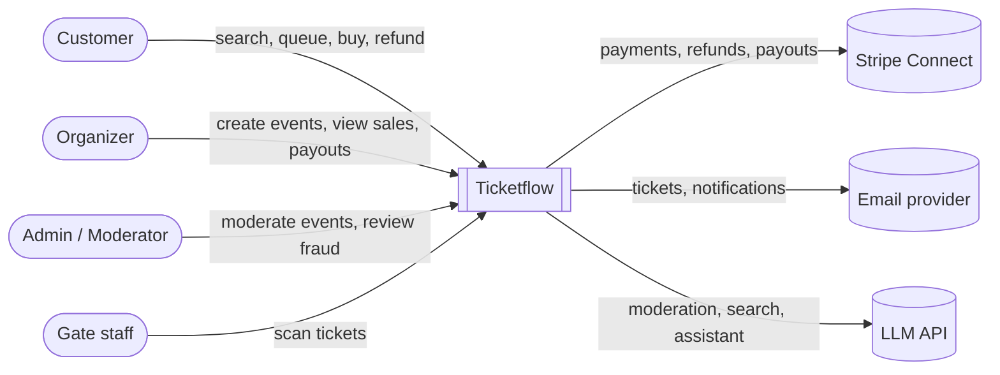

# Ticketflow — Architecture Documentation (arc42)

> Living document based on the [arc42](https://arc42.org) template.
> Sections marked _TBD_ will be filled in as the design matures.
> Decisions are recorded separately as [ADRs](../adr/README.md).

---

## 1. Introduction and Goals

### 1.1 Requirements overview

Ticketflow is a marketplace for event tickets:

- **Organizers** register, create events (concerts, sports, stand-up, festivals, …), define venues,
  seating plans or ticket pools, prices, purchase limits and refund policies. Revenue is paid out
  to organizers; the platform takes a fee.
- Every event listing is **moderated** (automated pre-screening, then admin review when needed)
  before it can go on sale.
- **Customers** browse and search events, pass through a **virtual waiting room**, hold seats for
  10 minutes, pay, and receive a **signed QR ticket** as a PDF by email.
- Organizers can enable **gate scanning**; a ticket can be used only once.
- Customers can **refund** tickets within the organizer's refund window; refunded tickets return to
  the pool. Cancelling an event triggers a **mass refund**.
- Per-event **purchase limits** (default: 1 ticket per person) are enforced without collecting
  additional personal data.
- **Bot and fraud detection** protects on-sales.

### 1.2 Quality goals

| Priority | Quality goal | Scenario |
|---|---|---|
| 1 | **Correctness under concurrency** | Two customers selecting the same seat at the same moment — exactly one gets it. A ticket is never sold twice; a payment is never captured twice. |
| 2 | **Resilience / elasticity** | 100 000 users arrive within one minute of an on-sale. The system stays responsive by admitting users at a controlled rate instead of failing. |
| 3 | **Reliability** | A failing downstream service (payments, email) never loses an order; work is retried or compensated. |
| 4 | **Security** | Tickets cannot be forged; purchase limits cannot be bypassed with multiple accounts; no card data touches our systems. |
| 5 | **Observability** | Any single purchase can be traced end-to-end across all services. |
| 6 | **Maintainability** | Services are independently buildable, testable and deployable; architectural rules are enforced by tests. |

### 1.3 Stakeholders

| Role | Expectation |
|---|---|
| Customer | Fair access to tickets, fast checkout, reliable delivery and refunds |
| Organizer | Simple event setup, reliable sales, transparent payouts |
| Admin / moderator | Efficient review queue, fraud visibility |
| Gate staff | Fast, reliable ticket validation (also with poor connectivity) |
| Developer / operator | Clear boundaries, automated delivery, good diagnostics |

---

## 2. Architecture Constraints

| Constraint | Background |
|---|---|
| Free tiers only | Local k3d, Oracle Cloud Always Free, GitHub free plan, Stripe test mode. AWS credits reserved for short, sessional experiments. |
| Cloud-agnostic | Everything runs on Kubernetes and is provisioned with Terraform, so the target cloud can change. |
| Java / Spring ecosystem | Primary language Java 25 with Spring Boot 4. |
| ARM64 + AMD64 | Oracle Always Free runs on ARM — all images are multi-architecture. |
| No PCI scope | Card data is handled exclusively by Stripe. |
| Single developer | Operational complexity must be automated (CI/CD, GitOps). |

---

## 3. Context and Scope

### 3.1 Business context (C4 — System Context)

### 3.2 Technical context

_TBD — after the container view (section 5) is drafted._

---

## 4. Solution Strategy

| Goal | Approach |
|---|---|
| Independent evolution of domains | Microservices aligned with DDD bounded contexts; database per service ([ADR-0002](../adr/0002-event-driven-microservices.md), [ADR-0006](../adr/0006-polyglot-persistence.md)) |
| Loose coupling, reliability | Asynchronous domain events over Kafka ([ADR-0005](../adr/0005-kafka-as-event-backbone.md)); transactional outbox ([ADR-0008](../adr/0008-transactional-outbox.md)); sagas with compensation |
| Read scalability | CQRS read models and Postgres read replicas ([ADR-0009](../adr/0009-cqrs-and-read-replicas.md)) |
| Surviving traffic spikes | Virtual waiting room ([ADR-0014](../adr/0014-virtual-waiting-room.md)), rate limiting, Redis seat holds, back-pressure |
| Security | Keycloak + OAuth2/OIDC, BFF ([ADR-0007](../adr/0007-identity-keycloak-and-bff.md)); signed tickets ([ADR-0015](../adr/0015-signed-qr-tickets.md)) |
| Clean, testable services | Hexagonal architecture inside each service, verified by ArchUnit |
| Fast, safe delivery | GitHub Actions + Argo CD GitOps, environments dev / qa / prod ([ADR-0011](../adr/0011-ci-github-actions-cd-argocd.md)) |

---

## 5. Building Block View

### 5.1 Candidate bounded contexts

Initial result of Event Storming — see [domain notes](../domain/event-storming.md).
Not every context becomes its own service on day one.

| Context | Responsibility | Primary store |
|---|---|---|
| Identity | Users, authentication, roles | Keycloak |
| Organizer | Organizer onboarding, Stripe Connect accounts, payouts | PostgreSQL |
| Event Catalog | Events, venues, seating plans, ticket pools, pricing | MongoDB |
| Moderation | Listing review workflow (automated + manual) | PostgreSQL |
| Search | Read model for browsing and search | OpenSearch |
| Waiting Room | Queueing and admission control per on-sale | Redis |
| Booking / Inventory | Seat availability, holds, purchase limits, orders | PostgreSQL + Redis |
| Payment | Payments, refunds, platform fee | PostgreSQL |
| Ticketing | Ticket issuance (signed QR, PDF), validation at the gate | PostgreSQL |
| Notification | Email delivery | — |
| Risk | Bot / fraud signals and scoring | Redis + _TBD_ |

### 5.2 Container view

_TBD — after context mapping._

---

## 6. Runtime View

_TBD — key scenarios: on-sale with waiting room, purchase saga, refund, event cancellation (mass refund), gate scan._

## 7. Deployment View

_TBD — local (Docker Compose → k3d), cloud (Oracle Cloud k3s: qa, prod), sessional AWS EKS._

## 8. Cross-cutting Concepts

_TBD — hexagonal service layout, event contracts & versioning, idempotency, error handling & DLQ, security, observability, testing strategy._

## 9. Architecture Decisions

See [ADR index](../adr/README.md).

## 10. Quality Requirements

_TBD — quality tree and measurable scenarios (latency, throughput, availability targets)._

## 11. Risks and Technical Debt

| Risk | Mitigation |
|---|---|
| Operational complexity exceeds what one developer can run | Walking skeleton first; automate everything; merge contexts into one service when separation is not yet justified |
| Local resource usage (Kafka, OpenSearch, Keycloak, observability) | Profiles in Compose / k3d to run only what is needed |
| Oracle Always Free capacity or account limits | Everything also runs locally; infrastructure is reproducible with Terraform |
| Distributed monolith from wrong boundaries | Event Storming and context mapping before implementation |

## 12. Glossary

| Term | Meaning |
|---|---|
| On-sale | The moment tickets for an event become available for purchase |
| Hold | Temporary reservation of seats/tickets (10 minutes) before payment |
| Ticket pool | A quantity of unnumbered tickets of one category (e.g. "Standing — 5 000") |
| Seating plan | Numbered seats organized in sections and rows |
| Card fingerprint | Stripe identifier that is unique per card number, without exposing the number |
| Mass refund | Refunding every ticket of a cancelled event |
