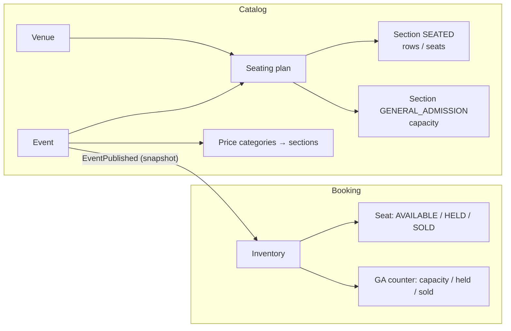

# Seating Model

> Result of board spike #12 (2026-11-05). First iteration implements `SEATED` and
> `GENERAL_ADMISSION` sections; other section types are deferred (ADR-0016).

## Concepts

| Concept | Owned by | Description |
|---|---|---|
| **Venue** | Catalog | A physical place (name, address). Belongs to an organizer, reusable across events. |
| **Seating plan** | Catalog | Layout of a venue, made of **sections**. Reusable across events at the same venue. |
| **Section** | Catalog | Either `SEATED` (rows → numbered seats) or `GENERAL_ADMISSION` (capacity only). |
| **Event** | Catalog | Title, description, date, venue + seating plan, **price categories** mapped to sections, purchase limit, refund window. |
| **Inventory** | Booking | Availability for one event, built from the published event. |

A mixed event (arena: standing floor + numbered stands) is a plan containing both section types.
Future types (festival passes, tables) become new section types without changing the overall model.

## Ownership split

- **Catalog knows what exists** — plan, prices, description.
- **Booking knows what is available** — when an event is published, Booking receives
  `EventPublished` and builds its own inventory:
  - `SEATED` section → one record per seat with status `AVAILABLE | HELD | SOLD`
  - `GENERAL_ADMISSION` section → counter: `capacity`, `held`, `sold`

During an on-sale Booking never calls Catalog — it has everything it needs.

